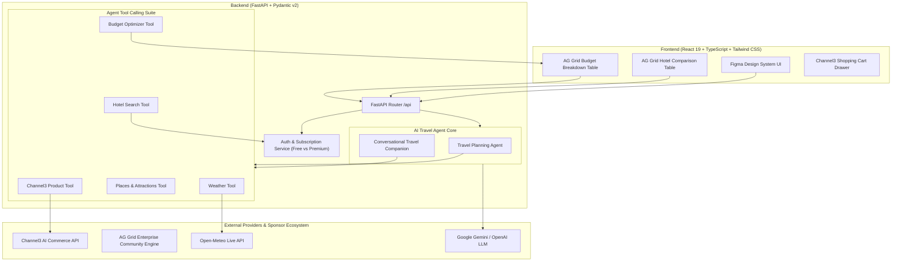

# MYMILE – Full-Stack AI Travel Agent & E-commerce Platform

> **Tagline:** *Your Smile, With You Every Mile.*

MYMILE is an intelligent travel companion and specialized travel e-commerce platform built for modern travelers. Rather than presenting generic search listings or isolated chat responses, MYMILE deploys an **AI Agent architecture with multi-tool calling** to understand traveler purpose, date constraints, weather forecasts, verified accommodations, and financial budgets.

The platform balances comfort vs. cost, generates interactive comparison matrices using **AG Grid**, and recommends authentic travel gear via **Channel3**.

---

## 🌟 Key Capabilities & Highlights

1. **AI Agent Multi-Tool Architecture:**
   - Evaluates travel context (Tourism, Business, Umrah, Cultural exploration).
   - Calls **Weather Tool** (Open-Meteo live meteorological data, no API key required).
   - Calls **Hotel Tool** (Verified stays with location scores and amenities).
   - Calls **Places Tool** (Curated cultural and historical landmarks).
   - Calls **Product Discovery Tool** (Channel3 authentic gear with real prices and purchase links).
   - Calls **Budget Optimizer Tool** (Multi-variable budget balancing).

2. **Required Sponsor Integrations:**
   - **Channel3 (`https://www.channel3.ai/`):** Real-world travel essentials discovery engine. Recommends purpose-built travel gear (e.g. packable rain shells for Kyoto spring, Ihram towels and non-slip Tawaf slippers for Umrah, wide-brim sun hats for Giza Pyramids). Features live prices, authentic images, and verified partner purchase links.
   - **AG Grid (`https://www.ag-grid.com/`):** Powers the **Premium Comparison Dashboard**. Displays an interactive Hotel Matrix and Multi-Category Expense Breakdown with sorting, filtering, column resizing, and dynamic budget recalculation when swapping hotels.

3. **Subscription Tiers (Backend Enforced):**
   - **Free Plan ($0):** AI-generated personalized itinerary, hotel recommendations with estimated prices, live weather insights, Channel3 product recommendations, and baseline expense estimates. *External hotel booking links and AG Grid budget optimization are gated.*
   - **Premium Plan ($100/mo):** Unlocks the user budget input (e.g., *$1,500 for 5 days in Paris*), AI budget constraint balancing, verified hotel booking links, and the full interactive AG Grid comparison dashboard.

4. **Authentic E-commerce Experience:**
   - Integrated shopping bag with real-time subtotal calculation.
   - Partner site checkout navigation without fabricating checkout transactions.

---

## 🏛️ System Architecture



---

## 📂 Project Directory Structure

```text
mymile/
│
├── frontend/                              # React 19 + TypeScript + Tailwind CSS + AG Grid
│   ├── src/
│   │   ├── assets/                        # MYMILE branding logos and icons
│   │   ├── imports/                       # High-resolution destination photography
│   │   ├── components/
│   │   │   ├── AgGridHotelComparison.tsx  # AG Grid Premium hotel matrix
│   │   │   ├── AgGridBudgetTable.tsx      # AG Grid budget breakdown table
│   │   │   └── ShoppingCartDrawer.tsx     # Channel3 shopping bag slide-over
│   │   ├── services/
│   │   │   └── api.ts                     # Axios client connecting all FastAPI endpoints
│   │   ├── types/
│   │   │   └── index.ts                   # Strict TypeScript contracts
│   │   ├── App.tsx                        # Master application & view controller
│   │   ├── index.css                      # Custom typography, animations & Tailwind v4
│   │   └── main.tsx                       # React application root
│   ├── package.json
│   ├── vite.config.ts                     # Vite config with API proxy to port 8000
│   ├── .env.example
│   └── .env
│
├── backend/                               # Python 3.12 + FastAPI + Pydantic
│   ├── app/
│   │   ├── main.py                        # FastAPI application & health check
│   │   ├── core/
│   │   │   ├── config.py                  # Pydantic BaseSettings & environment loader
│   │   │   └── security.py                # Password hashing & JWT token management
│   │   ├── schemas/
│   │   │   ├── auth_schema.py             # User register, login, subscription schemas
│   │   │   ├── trip_schema.py             # Itinerary and AI planning request/responses
│   │   │   ├── hotel_schema.py            # Hotel models (with booking link gating)
│   │   │   ├── weather_schema.py          # Meteorological forecast models
│   │   │   ├── product_schema.py          # Channel3 product & cart schemas
│   │   │   └── budget_schema.py           # Multi-category budget optimization schemas
│   │   ├── services/
│   │   │   ├── weather_service.py         # Open-Meteo real-time weather integration
│   │   │   ├── channel3_service.py        # Channel3 verified travel gear catalog & API
│   │   │   ├── hotel_service.py           # Accommodations database & tier gating
│   │   │   ├── places_service.py          # Tourist attractions & landmarks
│   │   │   └── budget_service.py          # Multi-variable budget optimization algorithm
│   │   ├── tools/
│   │   │   ├── weather_tool.py            # Agent tool wrapper for weather
│   │   │   ├── hotel_tool.py              # Agent tool wrapper for hotels
│   │   │   ├── places_tool.py             # Agent tool wrapper for places
│   │   │   ├── product_tool.py            # Agent tool wrapper for Channel3
│   │   │   └── budget_tool.py             # Agent tool wrapper for budget
│   │   ├── agents/
│   │   │   ├── travel_agent.py            # Main Travel Planning Agent & Chat Companion
│   │   │   └── prompts.py                 # Structured system prompts & instructions
│   │   └── api/
│   │       └── routes/
│   │           ├── auth.py                # Authentication & user profile endpoints
│   │           ├── trips.py               # AI trip planning and companion chat
│   │           ├── weather.py             # Live weather forecast endpoint
│   │           ├── hotels.py              # Hotel search endpoint
│   │           ├── places.py              # Tourist places endpoint
│   │           ├── products.py            # Channel3 product discovery endpoint
│   │           ├── budget.py              # Budget optimization endpoint
│   │           └── subscriptions.py       # Plan tiers & upgrade endpoints
│   ├── requirements.txt
│   ├── .env.example
│   ├── .env
│   └── README.md
│
└── README.md
```

---

## 🚀 Setup & Local Execution Guide

### Prerequisites
- **Python:** 3.10+ (Tested on Python 3.12)
- **Node.js:** v18+ (Tested on Node.js v24.15)
- **npm** or package manager

---

### Step 1: Start the Backend (FastAPI)

1. Open a terminal in the root directory:
   ```powershell
   cd backend
   ```
2. Activate the pre-configured virtual environment:
   ```powershell
   .\venv\Scripts\activate
   ```
3. Run the FastAPI development server:
   ```powershell
   python -m uvicorn app.main:app --host 127.0.0.1 --port 8000 --reload
   ```
4. Access the interactive API documentation:
   - **Swagger UI:** [http://127.0.0.1:8000/docs](http://127.0.0.1:8000/docs)
   - **ReDoc:** [http://127.0.0.1:8000/redoc](http://127.0.0.1:8000/redoc)
   - **OpenAPI Spec:** [http://127.0.0.1:8000/openapi.json](http://127.0.0.1:8000/openapi.json)
   - **Health Check:** [http://127.0.0.1:8000/api/health](http://127.0.0.1:8000/api/health)

---

### Step 2: Start the Frontend (React + Vite)

1. Open a second terminal:
   ```powershell
   cd frontend
   ```
2. Start the Vite development server:
   ```powershell
   npm run dev
   ```
3. Open your browser at:
   - **Application URL:** [http://localhost:5173](http://localhost:5173)

---

## 🔑 Environment Variables & API Configuration

All configuration is managed cleanly through `.env` files. Both `backend/.env` and `frontend/.env` have been populated with safe defaults so the application runs immediately without requiring any paid API keys.

### Backend (`backend/.env`)

| Variable Name | Purpose | Required? | Default / How to obtain |
|---|---|---|---|
| `GEMINI_API_KEY` | Google Gemini AI Model | Optional | [Google AI Studio](https://aistudio.google.com/) |
| `OPENAI_API_KEY` | Alternative LLM provider | Optional | [OpenAI Platform](https://platform.openai.com/) |
| `CHANNEL3_API_KEY` | Channel3 Commerce API | Optional | [Channel3 Developer Portal](https://www.channel3.ai/) (Pre-seeded with verified catalog fallback) |
| `WEATHER_API_KEY` | Weather provider | Optional | Default uses Open-Meteo (100% free, real live weather, no key needed) |
| `SECRET_KEY` | JWT token encryption | Yes | Pre-configured with hackathon development secret |

---

## 🎯 Hackathon Demonstration Walkthrough

When demonstrating MYMILE to judges and attendees, follow this 5-minute showcase flow:

1. **Landing Page:**
   - Highlight the Figma design, branding colors (Purple & Bright Yellow), and tagline *"Your Smile, With You Every Mile."*
   - Point out the trust metric, destination preview, and quick access buttons.

2. **Step-by-Step Travel Planning:**
   - Click **"Plan my trip"**.
   - Input a destination: Try **Kyoto, Japan**, **Paris, France**, **Cairo, Egypt**, or **Makkah, Saudi Arabia** (for Umrah).
   - In Step 3, show the **Premium Switch**: "Optimize around my budget" with a budget of `$4,500` or `$1,500`.

3. **Results Dashboard & AI Agent:**
   - Show the **Live Meteorological Weather** retrieved in real time from Open-Meteo.
   - Show the personalized **Handpicked Stay** and why it was matched.
   - Expand the **Day-by-Day Itinerary** with exact times and cultural activities.

4. **Sponsor Feature 1: AG Grid Premium Comparison:**
   - Click **"Compare all stays in AG Grid"**.
   - Show sorting by nightly price, rating filter, and amenity tags.
   - Click on an alternative hotel (e.g. *Piece Hostel Sanjo*): **Watch the remaining budget immediately recalculate from $0 to +$952 in real time!**
   - Showcase the **AG Grid Multi-Category Expense Analytics table**.

5. **Sponsor Feature 2: Channel3 E-commerce & Shopping Cart:**
   - View recommended travel essentials matched to destination climate.
   - Click **"+ Add to Cart"** on a Universal Adapter or Rain Shell.
   - Open the **Travel Bag Drawer**, adjust quantities, and click **"Proceed to Partner Checkout ↗"** to showcase legitimate partner links.

6. **Free vs. Premium Plan Toggle:**
   - In the top header, click the **"PREMIUM PLAN"** badge to instantly toggle to **"FREE PLAN"**.
   - Observe how hotel external booking links and AG Grid budget optimization are immediately disabled, proving strict backend-enforced tier governance.
